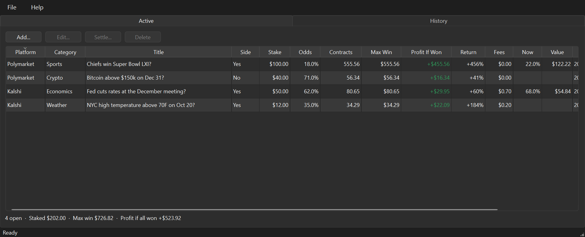

# Wager Book

A desktop book for wagers placed on Kalshi and Polymarket US: every open position and every
closed one, with the stake, the market-implied chance, the most it can pay, and what it
actually paid. PySide6, one JSON file, nothing sent anywhere.



## What it does

- **Active** tab: open wagers with platform, category, title, side, stake, odds, contracts,
  max win, profit and return if won, fees, current price and mark value, placed and close dates
- **History** tab: closed wagers with the result, payout, realised P&L and return
- **Add / Edit** dialog that works the contracts, max win and profit out as you type
- **Settle** dialog that fills in the usual payout for Won, Lost, Sold or Voided and lets you
  correct it; **Reopen** for a settlement made by mistake
- Totals under each table: open exposure and max win; closed count, win rate and net P&L
- **File > Import CSV** reads a Kalshi download, a Polymarket activity export or this app's
  own CSV, previews what it will add, skips rows already in the book, and lists rows it
  could not read with the reason
- Sorting on real values, **File > Export CSV**, light/dark theme, user manual on F1

The user manual is in [`docs/manual/README.md`](docs/manual/README.md), with the arithmetic.

## One-time setup

```powershell
cd W:\projects\26wagerBook
python -m venv .venv
.\.venv\Scripts\Activate.ps1
pip install -e ".[dev]"
```

## Daily workflow

```powershell
cd W:\projects\26wagerBook
.\.venv\Scripts\Activate.ps1
wager-book
```

Or without the script entry point:

```powershell
python -m wagerBook.main
```

Or just double-click **`runApp.cmd`** in the project folder (needs the one-time setup done first).

## Tests and lint

```powershell
pytest
ruff check src tests
```

## Where the data lives

`%APPDATA%\Wager Book\wagers.json` — every wager, open or closed. Rewritten whole on each
change through a temporary file, so a crash mid-write leaves the previous book intact.
`settings.ini` beside it holds the theme choice.

## Structure

| Layer | Folder | Purpose |
|-------|--------|---------|
| Entry | `src/wagerBook/main.py` | Start `QApplication`, show main window |
| Config | `src/wagerBook/appConfig.py` | Paths, defaults, app metadata, category list |
| Models | `src/wagerBook/models/wager.py` | `Wager` dataclass and its arithmetic; `Platform`, `Side`, `Status` |
| Services | `src/wagerBook/services/wagerStore.py` | The JSON book: load, save, add, update, settle, reopen, remove |
| | `src/wagerBook/services/wagerSummary.py` | Totals for the line under each table |
| | `src/wagerBook/services/exportCsvService.py` | CSV export |
| | `src/wagerBook/services/importService.py` | CSV import: header aliases, lenient values, duplicate rule; the column mapping is in its docstring |
| UI | `src/wagerBook/ui/wagers/` | Column definitions, table model, table view, the Active/History book view |
| | `src/wagerBook/ui/dialogs/wagerDialog.py` | Add / edit |
| | `src/wagerBook/ui/dialogs/settleDialog.py` | Settle |
| | `src/wagerBook/ui/dialogs/importDialog.py` | Import preview |
| | `src/wagerBook/ui/mainWindow.py` | Menus, status bar, hosts the book view |

Every change goes through `WagerStore` and both tabs are redrawn from it, so there is one
truth and nothing to keep in step by hand. Services import no Qt widgets.

See `AGENTS.md` for architecture and naming conventions (for you and AI agents).

---
*Created from the Qt App Template.*
