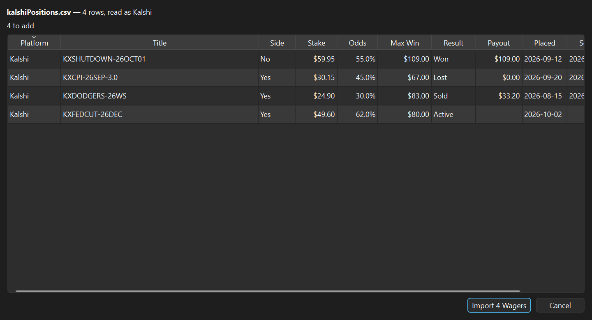

# Wager Book — user manual

Wager Book keeps a record of the wagers you place on **Kalshi** and **Polymarket US**: the
ones still open, and every one that has closed, with what it actually paid. Nothing is sent
anywhere; the book is a file on your own machine.

## The two tabs

**Active** holds every wager that has not been settled yet. **History** holds every wager that
has: won, lost, sold early, or voided. Settling a wager moves it from one tab to the other.
The line under each table adds up what is in it.

## Adding a wager

Click **Add...** on the Active tab, or press **Ctrl+N**. The fields:

| Field | What to put in it |
|-------|-------------------|
| Platform | Kalshi or Polymarket |
| Category | Politics, Sports, Economics and so on; type your own if none fits |
| Title | The market question, as the site words it |
| Ticker / Market Id | Paste the market's web address here, or type its ticker. Needed for Update Prices |
| Side | Yes or No — the side you bought |
| Price (Chance Of Winning) | What you paid per contract, in cents. 40 % means 40 cents, and is the market's own estimate that your side wins |
| Stake | The dollars you put in, before fees |
| Fees | What the site charged, if anything |
| Placed On | The day you bought |
| Closes On | When the market is expected to resolve, if you know it |
| Current Price | Optional. Update Prices fills this in; type a price here only for a market it cannot reach |
| Notes | Why you took it, what to watch for |

The line above the buttons works it out as you type: how many contracts the stake buys, the
most the wager can pay, and the profit if it wins.

### How the numbers are worked out

Both sites sell contracts that pay **$1** if your side is right and nothing if it is not, so:

- **Contracts** = Stake ÷ Price
- **Max Win** = Contracts × $1
- **Profit If Won** = Max Win − Stake − Fees
- **Return** = Profit If Won ÷ Stake

Because each contract pays $1, the number of contracts and the Max Win in dollars are the same
figure, so the table shows only Max Win. The add/edit form's summary line still states the
contract count.

A No wager uses the No price. Buying No at 70 cents is a 70 % chance in the market's eyes,
not 30 %.

## Updating prices

**Now** and **Value** show what each open wager could be sold for today. Click **Update
Prices** above the Active table, or press **F5**, and the app asks Kalshi and Polymarket for
the current price of every open wager. It takes a second or two, and the window stays usable
while it runs. Both sites publish prices publicly, so no login or API key is involved and
nothing about your account is sent.

The price used is the one you could **sell at right now**: the best bid for the side you hold.
That is what Kalshi's Cash Out shows, and it never flatters a position the way the last trade
or the asking price can. The line under the table then adds what the priced wagers are worth
now and the gain or loss against what they cost, with the time of the oldest price. Rest the
pointer on a Now or Value cell to see when that price was fetched, or whether it was typed in.

### Linking a wager to its market

A wager can only be priced once the app knows which market it is. Open the wager (double-click
it), click in **Ticker / Market Id**, and paste the address of the market's page from your
browser:

```
https://kalshi.com/markets/senatetx/texas-senate-winner/senatetx-26
https://polymarket.us/event/usse-me-2026-11-03
```

The app reads the address as you leave the box, fills in the market's id, and sets the
platform. Typing a Kalshi ticker or a Polymarket id directly works too.

On Polymarket, clicking a position in Portfolio opens a "You bought" card, not the market's
page. Close it, search for the market with the search box at the top, open it, and copy the
address from there.

Polymarket US and polymarket.com are separate exchanges with separate prices. The app asks
Polymarket US first, and polymarket.com only for an id the US exchange does not have, so a
wager is priced on the exchange its address came from. Copy the address from the site you
actually trade on.

Many addresses name a whole race, not one candidate. The app then picks the candidate whose
name appears in the wager's title - "Texas Senate winner? - Ken Paxton" finds Ken Paxton - and
stores that market's own id, so the next update goes straight to it. If no name or more than
one name in the race matches the title, the wager is not priced and the app lists the choices;
add the candidate's name to the title, or paste the candidate's own market address.

### When a wager is not priced

- **No ticker yet**: the status bar counts these. Link them as above.
- **Cannot be matched, closed, or nobody is bidding**: a box lists each wager and the reason.
  A closed market means the wager should be settled.
- **No connection**: nothing is changed, and the box says which site did not answer.

A wager that cannot be priced keeps its previous price. A Current Price typed into the form
is kept too, and is shown as entered by hand until the next update replaces it.

## Settling a wager

When a market resolves, select the wager on the Active tab and click **Settle...**. Choose
the outcome and the usual payout is filled in — the full Max Win for a win, nothing for a
loss, the stake back for a voided market — and can be changed to what actually arrived. For
a position you sold before the market resolved, choose **Sold** and enter what you got for
it. The wager then moves to History with its net result.

Settled by mistake? Select it on the History tab and click **Reopen**.

## Editing and deleting

Double-click a row, or select it and click **Edit...**, to change any field. **Delete** asks
first and then removes the wager for good. A wager that lost should be settled as Lost rather
than deleted, so the History totals stay true.

## Sorting

Click a column heading to sort by it; click again to reverse. Sorting on a money column
orders by the amount, not the text.

## Importing from a file

**File > Import CSV...** reads wagers out of a CSV file so they do not have to be typed one
at a time. Pick the file and a preview opens: how many rows will be added, how many are
already in the book, and the rows that could not be read with the reason for each. Nothing
reaches the book until you click **Import**.



### Getting the file

- **Kalshi** — on the website (not the mobile app), open the account menu and go to
  **Documents**, where the transaction history is a CSV per calendar year; some accounts find
  it under **Account > Tax Info** instead. Kalshi has changed the layout more than once, and the
  importer reads the shapes seen so far: the ledger with `Ticker, Type, Direction, Contracts,
  Average_Price, Created`, the paired-position file with entry and exit prices in cents, and
  the API's fills and settlements.
- **Polymarket** — there is no official download. The **Portfolio** and **Activity** pages can
  be copied into a spreadsheet, and the third-party exporters produce an `activity.csv` with
  `market_title, outcome, side, shares, price, usd_size, timestamp_utc`; both are read.
- **A spreadsheet of your own** — the easiest layout is this app's own export: run
  **File > Export CSV...** once for the header row, fill it in, and import it back.

### What the importer does with each row

- A **buy** becomes an open wager. A yes/no side, a price and either a stake or a number of
  contracts are needed; the title falls back to the ticker when the file has no title.
- Prices in **cents** (`63`) and in **dollars** (`0.63`) are both understood. A Yes price on
  a No wager is turned round.
- A row that carries a result — Won, Lost, an exit price of 100 or 0, a `market_result`, or
  Kalshi's settlement counts — becomes a closed wager with its payout and settled date.
- **Sells and redemptions** are listed, not imported: settle the matching wager in the app
  instead, so the book keeps one row per position. Deposits, withdrawals and rewards are
  listed too.
- A row for the **same market, same side and same day** as a wager already in the book is
  counted as already there, so importing the same file twice adds nothing.

Column names are matched loosely (`Market Ticker`, `market_ticker` and `market-ticker` are
the same), and extra columns are ignored.

## Export

**File > Export CSV...** writes every wager, open and closed, to a CSV file for a
spreadsheet or a backup. The same file can be imported back.

## Where the book lives

The book is one JSON file:

```
%APPDATA%\Wager Book\wagers.json
```

Copy it to back it up. If it is ever damaged the app says so at start-up and opens with an
empty book; move the damaged file aside, or fix it in a text editor, and start again.

`settings.ini` in the same folder remembers the theme from **Help > Theme** and where the window
was when you last closed it, so it reopens at the same place and size. A window last used on a
monitor that is no longer attached comes back on a screen you have. Delete `settings.ini` to
start from the defaults.
